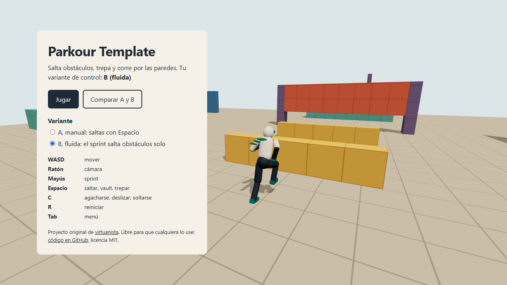
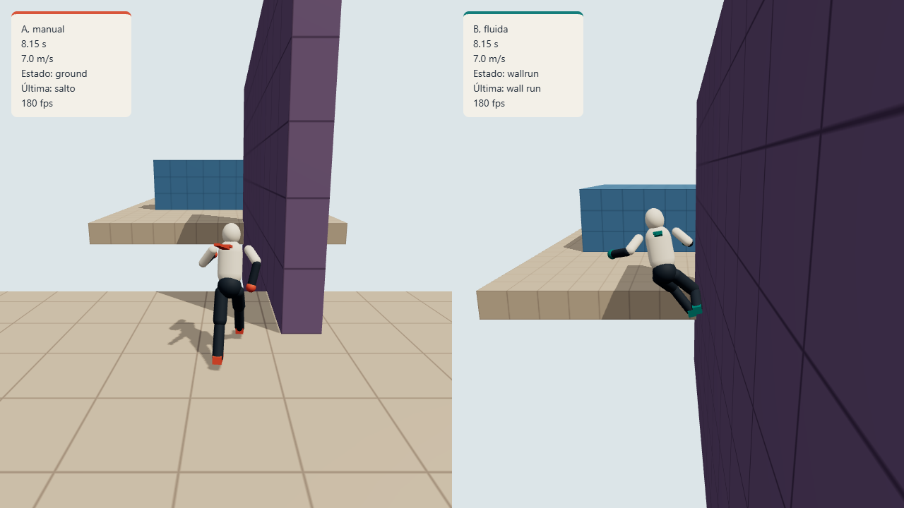

<p align="center"><a href="README.md">Español</a> · <b>English</b></p>

<div align="center">

# Parkour Template 🏃

**Your parkour game starts here.** An open third-person template for the browser, created by [virtuanista](https://github.com/virtuanista).

[](https://virtuanista.github.io/parkour-template/)
[](https://github.com/virtuanista/parkour-template/generate)




</div>

## What it is

An original project by virtuanista, ready for anyone to use in full: code, level, mannequin, animation, interface and tests. You can copy, modify and publish it, including for commercial purposes, as long as you keep the MIT license notice.

## Mechanics

| Mechanic | How to trigger it | How it works |
| --- | --- | --- |
| Run and sprint | WASD, Shift | Configurable acceleration and friction |
| Jump | Space | Grace period after leaving an edge (coyote time) and early press (buffer) |
| Vault | Space, or automatic in B | Obstacles 0.45 to 1.25 m high and up to 1.1 m deep |
| Mantle | Space, or automatic in B | Platforms up to 2 m with room to stand up |
| Ledge | Jump toward it | Grab, shimmy sideways, climb up or let go |
| Wall run | Jump next to a wall at over 4 m/s | Up to 1.3 s with reduced gravity |
| Wall jump | Space on the wall | Outward push |
| Slide | C at over 4.3 m/s | Low body; does not stand up if there is a ceiling |
| Roll | Land fast while moving | Keeps your speed; without it, a hard landing |
| Respawn | Fall into the void | Returns to the last checkpoint |



## What's included

- **Deterministic simulation** at 60 Hz, separate from rendering.
- **Environment detection** with traces: height, depth, clearance and landing ground.
- **Procedural animation** with two-bone IK: the hands reach for the actual edge.
- **Camera** with collision, and keyboard, mouse, gamepad and touch controls.
- **Two control variants**: A, manual, and B, fluid. 50/50 split, `?variant=A|B` to force one and `?mode=ab` to compare them.
- **Tests**: unit, A/B with 200 simulated runs per variant and E2E in Chrome, with CI and GitHub Pages.

## Getting started

Click *Use template* or clone the repository (Node 24):

```sh
git clone https://github.com/virtuanista/parkour-template.git
cd parkour-template
npm install
npm run dev
```

| Command | What for |
| --- | --- |
| `npm run check` | Types, build and all the tests |
| `npm run ab` | A/B results |
| `npm run preview` | View the build at `localhost:4173` |

## Make it yours

| To change | File |
| --- | --- |
| Speeds, heights and timings | `src/core/config.ts` |
| The level | `src/core/level.ts` |
| States and moves | `src/core/character.ts` |
| Character and animation | `src/view/rig.ts` |
| Lights, colors and camera | `src/view/stage.ts` |
| Menu and interface | `index.html`, `src/style.css` |

## Limitations

Collisions with straight boxes, no ramps or meshes; no multiplayer. The A/B uses bots, so it is no substitute for real players. Gamepad and touch have not yet been tested on physical devices.

## License

Original code, level and art under [MIT](LICENSE), with mechanics common to the genre. three.js (MIT) belongs to its authors. No code or assets from other games or engines.

<p align="center">
	Repository made by <a href="https://github.com/virtuanista" target="_blank">virtu 🎣</a>
</p>

<p align="center">
	
</p>

<p align="center">
	Copyright &copy; 2026
</p>

<p align="center">
	<a href="LICENSE"></a>
</p>
