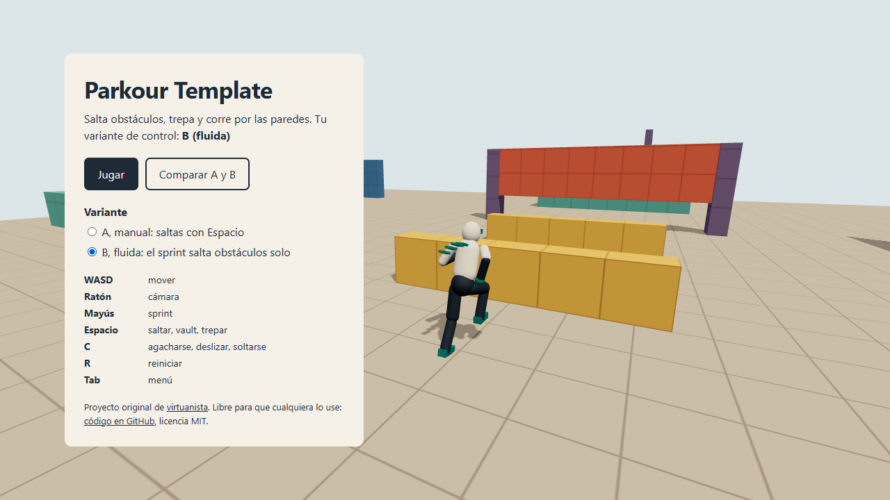
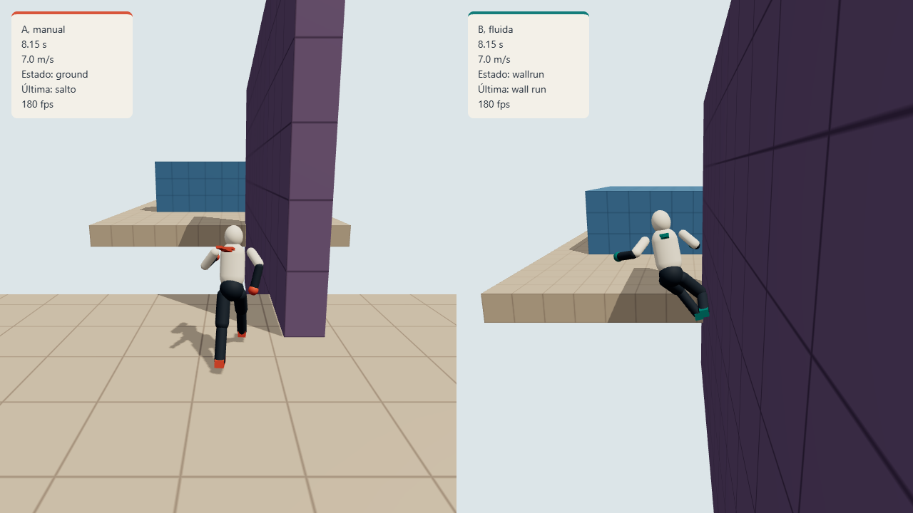

<p align="center"><b>Español</b> · <a href="README.en.md">English</a></p>

<div align="center">

# Parkour Template 🏃

**Tu juego de parkour empieza aquí.** Plantilla abierta en tercera persona para navegador, creada por [virtuanista](https://github.com/virtuanista).

[](https://virtuanista.github.io/parkour-template/)
[](https://github.com/virtuanista/parkour-template/generate)




</div>

## Qué es

Un proyecto original de virtuanista, listo para que cualquiera lo use entero: código, nivel, maniquí, animación, interfaz y pruebas. Puedes copiarlo, modificarlo y publicarlo, también con fines comerciales, conservando el aviso de la licencia MIT.

## Mecánicas

| Mecánica | Cómo se activa | Cómo funciona |
| --- | --- | --- |
| Carrera y sprint | WASD, Mayús | Aceleración y fricción configurables |
| Salto | Espacio | Margen al salir del borde (coyote time) y pulsación anticipada (buffer) |
| Vault | Espacio, o automático en B | Obstáculos de 0,45 a 1,25 m y hasta 1,1 m de fondo |
| Mantle | Espacio, o automático en B | Plataformas de hasta 2 m con sitio para ponerse de pie |
| Cornisa | Saltar hacia ella | Agarre, desplazamiento lateral, trepar o soltarse |
| Wall run | Saltar junto a un muro a más de 4 m/s | Hasta 1,3 s con gravedad reducida |
| Wall jump | Espacio en la pared | Impulso hacia fuera |
| Deslizar | C a más de 4,3 m/s | Cuerpo bajo; no se levanta si hay techo |
| Voltereta | Caer rápido en movimiento | Conserva la velocidad; sin ella, caída dura |
| Reaparición | Caer al vacío | Vuelve al último punto de control |



## Qué trae

- **Simulación determinista** a 60 Hz, separada del render.
- **Detección del entorno** por trazas: altura, fondo, espacio libre y suelo de salida.
- **Animación procedural** con IK de dos huesos: las manos buscan el borde real.
- **Cámara** con colisión, y controles de teclado, ratón, mando y táctil.
- **Dos variantes de control**: A, manual, y B, fluida. Reparto 50/50, `?variant=A|B` para forzarla y `?mode=ab` para compararlas.
- **Pruebas** unitarias, A/B con 200 recorridos simulados por variante y E2E en Chrome, con CI y GitHub Pages.

## Empezar

Pulsa *Usar plantilla* o clona el repositorio (Node 24):

```sh
git clone https://github.com/virtuanista/parkour-template.git
cd parkour-template
npm install
npm run dev
```

| Comando | Para qué |
| --- | --- |
| `npm run check` | Tipos, build y todas las pruebas |
| `npm run ab` | Resultados A/B |
| `npm run preview` | Ver el build en `localhost:4173` |

## Hazlo tuyo

| Quieres cambiar | Archivo |
| --- | --- |
| Velocidades, alturas y tiempos | `src/core/config.ts` |
| El nivel | `src/core/level.ts` |
| Estados y movimientos | `src/core/character.ts` |
| Personaje y animación | `src/view/rig.ts` |
| Luces, colores y cámara | `src/view/stage.ts` |
| Menú e interfaz | `index.html`, `src/style.css` |

## Límites

Colisiones con cajas rectas, sin rampas ni mallas; sin multijugador. El A/B usa bots, así que no sustituye a jugadores reales. El mando y el táctil aún no se han probado en dispositivos físicos.

## Licencia

Código, nivel y arte originales bajo [MIT](LICENSE), con mecánicas habituales del género. three.js (MIT) pertenece a sus autores. Sin código ni assets de otros juegos o motores.

<p align="center">
	Repositorio generado por <a href="https://github.com/virtuanista" target="_blank">virtu 🎣</a>
</p>

<p align="center">
	
</p>

<p align="center">
	Copyright &copy; 2026
</p>

<p align="center">
	<a href="LICENSE"></a>
</p>
